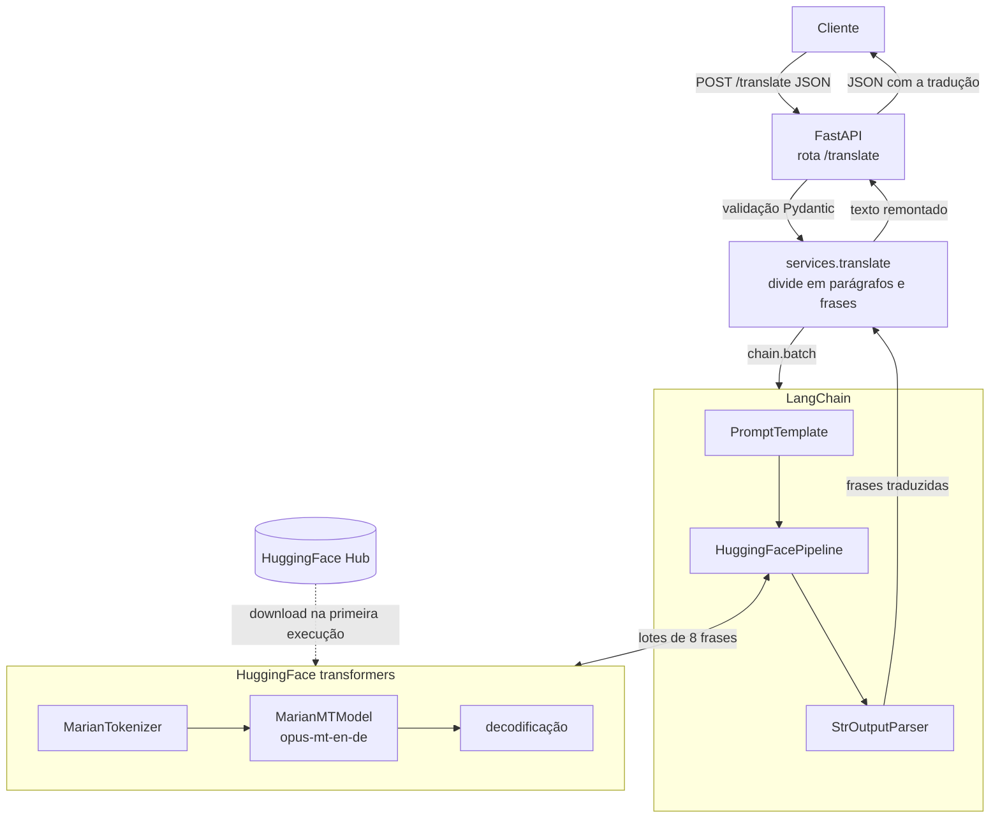

# Tradução Inglês para Alemão com HuggingFace, LangChain e FastAPI

API desenvolvida com FastAPI que recebe um texto em inglês e o traduz para o alemão com o modelo `Helsinki-NLP/opus-mt-en-de`, executado localmente e gerenciado pelo LangChain através da integração `langchain-huggingface`.

## Arquitetura



1. Na inicialização, o `HuggingFacePipeline.from_model_id` baixa (apenas na primeira vez) e carrega o tokenizador e o modelo em memória.
2. O cliente envia o texto em inglês para `POST /translate`, validado pelo Pydantic.
3. O serviço divide o texto em parágrafos e frases, respeitando o limite de 512 tokens do modelo.
4. A chain do LangChain (`PromptTemplate`, `HuggingFacePipeline`, `StrOutputParser`) processa as frases com `batch`, em lotes de 8.
5. O `HuggingFacePipeline` repassa cada lote ao pipeline de tradução do `transformers`, que tokeniza, gera e decodifica o texto em alemão.
6. As frases traduzidas são remontadas mantendo os parágrafos e devolvidas em JSON.

## Estrutura

```
.
├── main.py           # criação da aplicação e carregamento do modelo na inicialização
├── models.py         # modelos Pydantic de requisição e resposta
├── routes.py         # endpoints da API
├── services.py       # chain do LangChain com HuggingFacePipeline
└── requirements.txt
```

## Requisitos

- Python 3.12 ou superior
- Cerca de 2 GB livres para as dependências e o modelo
- `transformers` na versão 4.x, pois a versão 5 removeu o pipeline de tradução usado pelo `HuggingFacePipeline`

## Como executar

```bash
python3 -m venv venv
source venv/bin/activate
pip install -r requirements.txt
uvicorn main:app --reload
```

A documentação interativa fica disponível em http://127.0.0.1:8000/docs.

## Endpoints

| Método | Rota | Descrição |
|--------|------|-----------|
| GET | `/` | Verifica se a API está no ar |
| POST | `/translate` | Traduz um texto do inglês para o alemão |

### POST /translate

```bash
curl -X POST http://127.0.0.1:8000/translate \
  -H "Content-Type: application/json" \
  -d '{"text": "Good morning, my friend."}'
```

Resposta:

```json
{
  "model": "Helsinki-NLP/opus-mt-en-de",
  "source_language": "en",
  "target_language": "de",
  "original_text": "Good morning, my friend.",
  "translated_text": "Guten Morgen, mein Freund."
}
```
